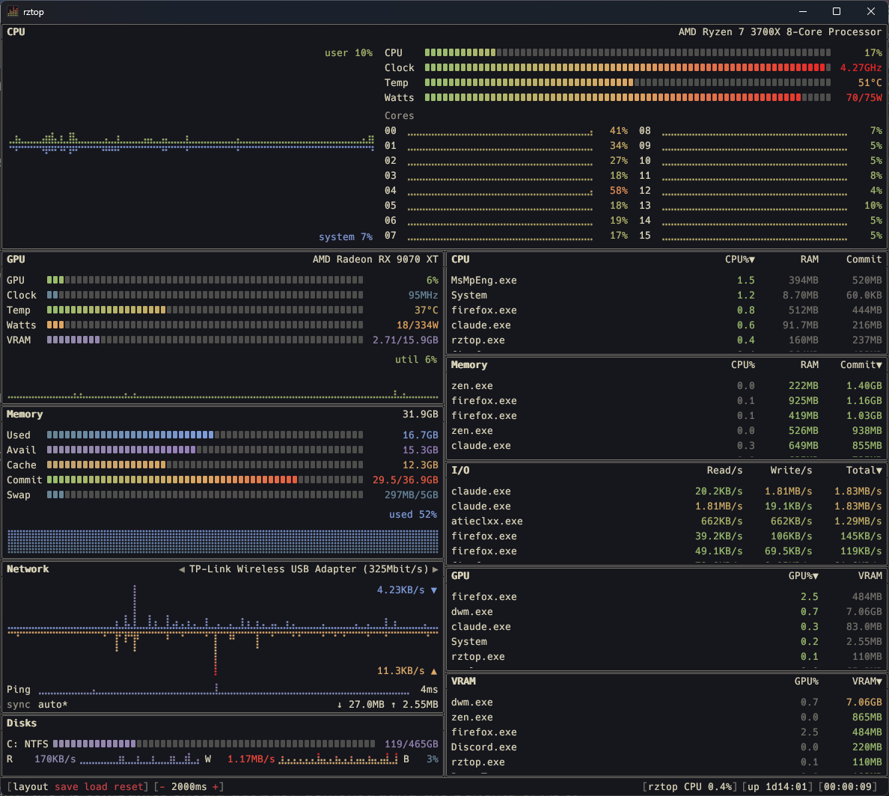

<div align="center">

# rztop

**A desktop system monitor for Windows.**

[](#installation)
[](https://www.rust-lang.org/)
[](LICENSE)



</div>

rztop is a fork of [rtop by Freddie Haddad](https://github.com/freddiehaddad/rtop),
a terminal system monitor inspired by [btop](https://github.com/aristocratos/btop).
rztop keeps rtop's Windows-native data collection and its look (themes, gradients,
dot graphs) and replaces the terminal interface with a native window of dockable
panels. If you want a terminal monitor, use rtop.

The original copyright and the GPL-2.0-or-later license are retained. Fork changes
began on 2026-11-02; modified files are marked with a `Modified for rztop` header.

## Features

| Panel | Shows |
|-------|-------|
| **CPU** | Total and per-core usage graphs, clock, temperature¹ and power¹ |
| **GPU** | Utilization, VRAM, power and clock graphs; temperature. NVIDIA, AMD and Intel |
| **Memory** | Used, available, cached, commit and swap meters |
| **Network** | Download/upload graphs with auto-scaling, adapter selector, ping history |
| **Disks** | Per-volume usage, read/write throughput and busy time |
| **I/O** | Processes ranked by read/s, write/s or total |
| **CPU / Memory / GPU / VRAM** | Processes ranked by each resource |

¹ Needs [PawnIO](#cpu-temperature-and-power) and administrator rights.

- **Dockable layout**: drag a panel's caption onto another panel to split it or group the two as tabs; drag separators to resize.
- **Layout controls** in the status bar: **save** stores the current arrangement and window position, **load** restores it, **reset** returns to the default arrangement sized to fit the window.
- **Status bar**: refresh interval (click `-` / `+`), rztop's own CPU usage, uptime, clock, and a warning when rztop is not elevated and some data is unavailable.
- **41 bundled themes** shared with rtop.
- Sizes are labelled MB and GB like Task Manager (1024-based; `base_10_sizes = true` switches to 1000-based).

## Installation

No release is published yet. Build from source:

**Requirements**

- [Rust](https://rustup.rs/), stable toolchain (1.95 or newer)
- Windows 10/11 SDK (included with the Visual Studio Build Tools)

```powershell
cargo build --release
```

The app is `target\release\rztop.exe`. Run the tests with `cargo test`.

## CPU temperature and power

CPU temperature and power come from [PawnIO](https://pawnio.eu), a signed kernel
driver that lets rztop read the CPU's sensors. It supports Intel, and AMD Zen and
newer. Without PawnIO those readings stay blank and everything else works.

```powershell
winget install --id namazso.PawnIO
```

Then run rztop as administrator (right-click `rztop.exe` → **Run as administrator**).

## GPU monitoring

GPUs from all three vendors are detected at start-up. GPU monitoring needs only the
vendor's graphics driver, and no elevation.

| Vendor | Supported GPUs |
|--------|----------------|
| **NVIDIA** | GeForce 600 series (Kepler) and newer |
| **AMD** | Vega and newer (RX Vega, 5000, 6000, 7000, 9000 series) |
| **Intel** | Arc discrete GPUs |

If a vendor's driver is not installed, that backend is skipped.

## Configuration

rztop reads an optional config file and never writes it:

| What | Where |
|------|-------|
| Config | `%APPDATA%\rztop\rztop.toml` (or `$XDG_CONFIG_HOME\rztop\`) |
| Log | `%LOCALAPPDATA%\rztop\rztop.log` (or `$XDG_STATE_HOME\rztop\`) |
| Window and layout | `%APPDATA%\rztop\data\app.ron` |

An rtop `rtop.toml` can be copied over; keys the desktop app does not use are
ignored. The keys it reads:

```toml
color_theme = "default"        # any bundled theme, e.g. "dracula", "nord", "tokyo-night"
update_ms = 2000               # refresh interval, 100..86400000
base_10_sizes = false
temp_scale = "celsius"         # celsius, fahrenheit, kelvin, rankine
statusbar_clock_format = "%T"  # %T %R %H %I %M %S %p; "" hides the clock
log_level = "warn"             # off, error, warn, info, debug, trace

# Meter scales; 0 means automatic
cpu_clock_max_mhz = 0
gpu_clock_max_mhz = 0
gpu_power_max_watts = 0        # e.g. your card's board power rating
swap_max_mib = 0               # 0 = current pagefile allocation

# Network
net_iface = ""                 # adapter to show first
net_auto = true                # auto-scale the graphs
net_sync = false               # same scale for download and upload
net_download = 100             # fixed scale when not auto-scaling, in KiB/s
net_upload = 100

# Disks and processes
disk_filter = []               # e.g. ["C:", "!D:"]
memory_sort_ram = false        # rank memory by RAM instead of commit
io_sort = "total"              # read, write, total
proc_per_core = false          # 100% = one logical core
```

### Notes on the data

- **Process memory** is private committed bytes (Commit); RAM is the working set.
- **Process GPU** is the busiest engine per process across GPUs; VRAM is dedicated memory summed across adapters.
- **Process I/O** is general Windows I/O (file, network, devices), not only disk throughput. A rate needs two samples of the same process.
- **Swap** comes from `EnumPageFilesW`. `swap_max_mib` only changes the display scale, never Windows paging settings.
- **Ping** probes `1.1.1.1` once per refresh with a one-second timeout. Set the `RTOP_PING_TARGET` environment variable to another IPv4 address to change it.
- **Clock and power scales** never change hardware settings. See [AMD API notes](docs/amd-references.md).

## Acknowledgments

- [rtop](https://github.com/freddiehaddad/rtop) by Freddie Haddad, which rztop is forked from
- [btop](https://github.com/aristocratos/btop) by aristocratos, which inspired rtop's design
- [egui](https://github.com/emilk/egui) and [egui_dock](https://github.com/Adanos020/egui_dock) for the window and docking
- [windows-rs](https://github.com/microsoft/windows-rs) for the Windows API bindings
- [PawnIO](https://pawnio.eu) by namazso, the signed kernel driver for CPU sensor access
- [PawnIO.Modules](https://github.com/namazso/PawnIO.Modules): the `IntelMSR` and `AMDFamily17` modules embedded by rztop, licensed under LGPL-2.1-or-later

## License

[GPL-2.0-or-later](LICENSE). The original rtop code is copyright (C) 2026 Freddie Haddad.
